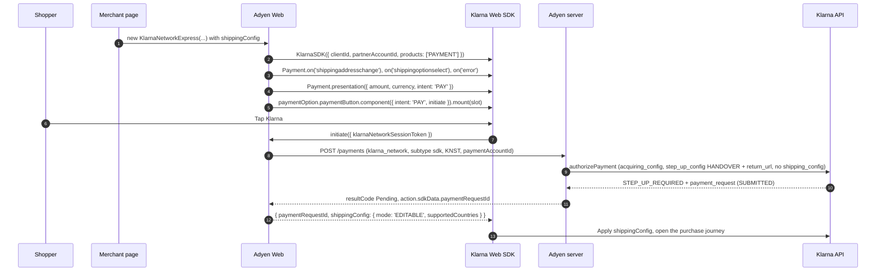
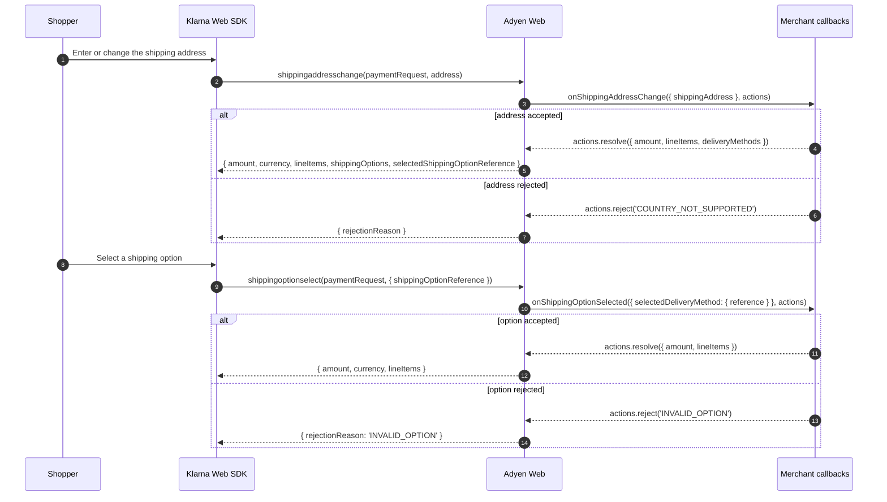
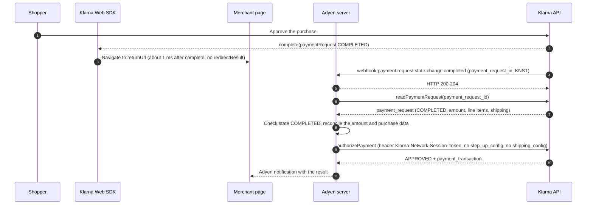
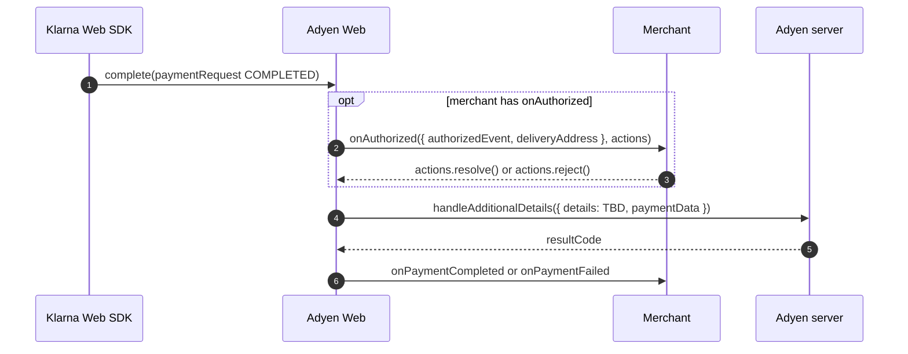

# Klarna Network Express Checkout: Technical Design Doc

| Field         | Value                                     |
| ------------- | ----------------------------------------- |
| Author        | Guilherme Scotti                          |
| Reviewers     | TBD                                       |
| Status        | In progress (POC on `feature/klarna-poc`) |
| Product Owner | TBD                                       |

## 1. Summary

Klarna is one button in the Express Checkout row. The shopper taps it, approves in Klarna, and can change the shipping address and shipping option inside Klarna.

The flow authorizes on the server first:

1. The Klarna button's `initiate` callback calls `/payments`.
2. The Adyen server calls Klarna `authorizePayment`. Klarna answers `STEP_UP_REQUIRED` and creates a payment request in `SUBMITTED`.
3. `initiate` returns `{ paymentRequestId, shippingConfig: { mode: 'EDITABLE', supportedCountries } }`. The Klarna Web SDK applies the shipping config and opens the Klarna purchase journey.
4. Shipping changes fire Web SDK events. Adyen Web forwards them to the merchant callbacks and returns the new totals to Klarna.
5. When the shopper approves, Klarna sends the `payment.request.state-change.completed` webhook to the Adyen server. The server reads the payment request and authorizes again with the Klarna Network Session Token (KNST).

The POC covers steps 1 to 4 in Adyen Web. How the browser finishes the payment (section 6) and how cancel and errors reach the merchant (section 7) are designed here but not implemented yet.

## 2. Current POC

Adyen Web has two Klarna Network components. Both use `Payment.presentation()`, which renders Klarna's on-site message and the Klarna button.

| Variant                          | Class                  | Shipping                   | Story                                                                     |
| -------------------------------- | ---------------------- | -------------------------- | ------------------------------------------------------------------------- |
| Regular (standalone and Drop-in) | `KlarnaNetwork`        | None                       | `Components/KlarnaNetwork/Regular`, `Drop-in/Drop-in with Klarna Network` |
| Express Checkout                 | `KlarnaNetworkExpress` | Editable, `shippingConfig` | `Components/KlarnaNetwork/Express Presentation`                           |

Returning `paymentRequestId` without `shippingConfig` opens a payment request that is not editable, and the shipping events never fire. That was why shipping was never editable in earlier POC tests.

## 3. Klarna Web SDK

### 3.1 Reference docs

- [Klarna: Express checkout aggregation (Adyen)](https://docs.klarna.com/adyen-mmaqkau5kubmnjbhkiofzp/express-checkout/express-checkout-aggregation/)
- [Klarna: `authorizePayment`](https://docs.klarna.com/adyen-mmaqkau5kubmnjbhkiofzp/api/klarna-product-api-payment/#tag/Payment-Authorize-API/operation/authorizePayment)
- [Klarna: `readPaymentRequest`](https://docs.klarna.com/adyen-mmaqkau5kubmnjbhkiofzp/api/klarna-product-api-payment/#tag/Payment-Request-API/operation/readPaymentRequest)
- [Klarna Web SDK: `InitiateCallback`](https://docs.klarna.com/websdk/v2/types/payment.InitiateCallback.html)
- [Klarna: sample customer data](https://docs.klarna.com/acquirer/klarna/resources/developer-tools/sample-data/sample-customer-data/)
- Who prices shipping: [KlarnaNetwork-Shipping-Pricing.md](./KlarnaNetwork-Shipping-Pricing.md)

### 3.2 Initialization parameters

| Parameter          | Value in the POC                             | Notes                                                                      |
| ------------------ | -------------------------------------------- | -------------------------------------------------------------------------- |
| `clientId`         | Merchant configuration (`.env` in Storybook) | Adyen's Web SDK client id, shared across partners.                         |
| `partnerAccountId` | Merchant configuration                       | One per partner (sub-merchant).                                            |
| `acquiringConfig`  | `{ paymentAccountId }`                       | The partner's Payment Acquiring Account. Also sent to `/payments`.         |
| `products`         | `['PAYMENT']`                                | Klarna logs harmless "Customer/Identity/Messaging not initialized" errors. |
| `locale`           | `i18n.locale`                                |                                                                            |

The SDK loads from `https://js.klarna.com/web-sdk/v2/klarna.mjs`. Klarna does not allow bundling or self-hosting it.

### 3.3 Button API: `presentation()` instead of `button()`

Klarna's Express docs mount the button with `Payment.button()`. The POC uses `Payment.presentation()`, because both variants then share one API and the regular component already needs the message.

We tested both on the Klarna playground. They only differ before the click:

|                   | `presentation()`                                                                                                    | `button()`               |
| ----------------- | ------------------------------------------------------------------------------------------------------------------- | ------------------------ |
| Request at render | `GET /na/cma/v4/messaging/presentation`                                                                             | None                     |
| On-site message   | Yes                                                                                                                 | No                       |
| Our `initiate`    | Wrapped by Klarna                                                                                                   | Passed through unchanged |
| After the click   | Same payment request PATCH: `shipping_config`, product `KEC`, `SHIPPING_ADDRESS_SUPPORT`, `SHIPPING_OPTION_SUPPORT` | Same                     |
| Purchase journey  | Same popup                                                                                                          | Same popup               |

**Decision:** keep `presentation()` and remove the `button()` variant. Klarna still has to confirm that the message is fine in an Express Checkout row (section 11).

### 3.4 Events

`Payment.on()` accepts `abort`, `complete`, `error`, `shippingaddresschange` and `shippingoptionselect`. Any other name throws `Unsupported event`.

| Event                   | First argument                | Second argument                                            | Used by the POC |
| ----------------------- | ----------------------------- | ---------------------------------------------------------- | --------------- |
| `shippingaddresschange` | Payment request (`SUBMITTED`) | Partial address: `city`, `postalCode`, `region`, `country` | Yes             |
| `shippingoptionselect`  | Payment request (`SUBMITTED`) | `{ shippingOptionReference }` only                         | Yes             |
| `complete`              | Payment request (`COMPLETED`) | None                                                       | No (section 6)  |
| `abort`                 | Payment request (`SUBMITTED`) | None                                                       | No (section 7)  |
| `error`                 | Error                         | Payment request                                            | Logs only       |

The payment request carries `paymentRequestId`, `paymentRequestReference`, `state` and `stateContext`. On `complete`, `stateContext` also has the shipping recipient and address, `paymentToken` and `klarnaNetworkSessionToken`. Never log these tokens.

Adyen Web does not pass the payment request to the merchant. Merchants match the shipping quote to their own cart or `reference`, and the Adyen server reads the final amount from Klarna (section 9).

## 4. Flow

### 4.1 SDK setup, the click, and the step-up

### 4.2 Editable shipping

### 4.3 Approval, webhook and final authorization (as tested)

Klarna navigates to the `return_url` that the Adyen server sent in `step_up_config`. The URL has no `redirectResult`, so the `returnUrl` page cannot call `/payments/details`. Today the merchant only learns the result from the Adyen notification.

## 5. Shipping

### 5.1 Merchant API

The Express component follows the PayPal and Apple Pay Express pattern: a callback per event, with `actions.resolve` and `actions.reject`.

| Callback                   | Data from Adyen Web                                                       | Resolve with                               |
| -------------------------- | ------------------------------------------------------------------------- | ------------------------------------------ |
| `onShippingAddressChange`  | `{ shippingAddress }`: `city`, `postalCode`, `stateOrProvince`, `country` | `{ amount, lineItems?, deliveryMethods? }` |
| `onShippingOptionSelected` | `{ selectedDeliveryMethod: { reference } }`                               | `{ amount, lineItems? }`                   |

- Klarna sends only the reference on option select. The merchant must remember the price it quoted for each reference.
- Klarna sends a partial address during the journey (no street or name). The full address only arrives with `complete`.
- Both events are always registered, as Klarna requires. With no merchant callback, the handler rejects with the default reason.

### 5.2 Rejections

| Event          | Reasons Klarna accepts                                                                                                               | Adyen Web default       |
| -------------- | ------------------------------------------------------------------------------------------------------------------------------------ | ----------------------- |
| Address change | `COUNTRY_NOT_SUPPORTED`, `REGION_NOT_SUPPORTED`, `CITY_NOT_SUPPORTED`, `POSTAL_CODE_NOT_SUPPORTED`, `ADDRESS_NOT_SUPPORTED`, `OTHER` | `ADDRESS_NOT_SUPPORTED` |
| Option select  | `INVALID_OPTION`                                                                                                                     | `INVALID_OPTION`        |

**Known Klarna issue:** returning `{ rejectionReason: 'INVALID_OPTION' }` matches Klarna's docs, which say the shopper stays on the shipping step. On the playground, Klarna showed "Oops, we have an error" instead, then displayed the rejected option as selected with the old total, and finally spun forever. To raise with Klarna (error ID `ad43f5b0-41f1-4c20-999e-356a7c3ebd56`).

### 5.3 Who prices shipping

The POC lets the merchant price shipping in the callbacks. Klarna's docs price it on the Adyen server. See [KlarnaNetwork-Shipping-Pricing.md](./KlarnaNetwork-Shipping-Pricing.md).

## 6. Completing the payment (proposed, not implemented)

Adyen Web should finish the payment the same way as PayPal. PayPal's `handleOnApprove` calls the merchant's optional `onAuthorized(data, { resolve, reject })` with the addresses, then `handleAdditionalDetails({ data: { details, paymentData } })`, which sends `/payments/details`.

- `deliveryAddress` comes from `stateContext.shipping.address`, mapped with `mapKlarnaAddressToAdyen`.
- `paymentData` is in the `/payments` action today. Adyen Web would store it in `authorize`.

**Blockers:**

1. Klarna navigates away about 1 ms after `complete`, so nothing async can finish. The Adyen server must stop sending a `return_url` for this flow, or Klarna must offer a step-up method that keeps the shopper on the page.
2. The `/payments/details` contract is not defined: which `details` (for example `paymentRequestId`), and whether it waits for the webhook's final authorization.

## 7. Cancel, decline and errors (deferred)

These cases are out of scope for the POC on purpose and will be implemented later. Today Adyen Web only logs Klarna `error` and sets the element back to `ready`.

### 7.1 What happens today

| Case                                    | What the shopper sees                                                                                    | SDK event                                    |
| --------------------------------------- | -------------------------------------------------------------------------------------------------------- | -------------------------------------------- |
| Klarna declines (denied sample shopper) | "We couldn't approve you for this payment option" inside the popup, with "Choose another payment option" | None                                         |
| Shopper closes the popup                | Klarna overlay on the merchant page: "Something went wrong. Please close this window to continue."       | `abort`, only after the overlay is dismissed |
| Klarna technical error                  | "Well, this is awkward" in the popup, then the same overlay                                              | `abort` after the overlay is dismissed       |
| Option rejected with `INVALID_OPTION`   | See 5.2                                                                                                  | None                                         |

`error` never fired in any test. While Klarna's overlay is open, it blocks the Klarna button and the rest of the page.

### 7.2 Proposed handling (PayPal standard)

| Klarna event | Adyen Web                                                                                        | Merchant sees                            |
| ------------ | ------------------------------------------------------------------------------------------------ | ---------------------------------------- |
| `abort`      | `this.handleError(new AdyenCheckoutError('CANCEL'))`, element back to `ready`                    | `onError` with `CANCEL`                  |
| `error`      | `this.handleError(new AdyenCheckoutError('ERROR', message, { cause }))`, element back to `ready` | `onError` with `ERROR`                   |
| `complete`   | Section 6                                                                                        | `onPaymentCompleted` / `onPaymentFailed` |

PayPal does the same: its `onCancel` calls `this.handleError(new AdyenCheckoutError('CANCEL'))`. A Klarna failure must fail Klarna only, and the other Express Checkout methods stay usable.

## 8. Where each step lives in the code

All paths are under `packages/lib/src/components/KlarnaNetwork/`.

| Step                                          | Function                                                                                                  | File                                                                                   |
| --------------------------------------------- | --------------------------------------------------------------------------------------------------------- | -------------------------------------------------------------------------------------- |
| Load the Web SDK from `js.klarna.com`         | `loadKlarnaSdk`                                                                                           | `utils/load-klarna-sdk.ts`                                                             |
| Init the SDK, register events                 | `setUpKlarna` (first `useEffect`)                                                                         | Each container                                                                         |
| Get the presentation                          | `payment.presentation()` inside `setUpKlarna`                                                             | Each container                                                                         |
| Mount the button                              | Second `useEffect`, `paymentOption.paymentButton.component({ intent, initiate })`                         | Each container                                                                         |
| Return `{ paymentRequestId }`                 | `initiate`                                                                                                | `components/KlarnaPresentationContainer/KlarnaPresentationContainer.tsx`               |
| Return `{ paymentRequestId, shippingConfig }` | `initiate`                                                                                                | `components/KlarnaExpressPresentationContainer/KlarnaExpressPresentationContainer.tsx` |
| Call `/payments`, read the payment request id | `KlarnaNetwork.authorize` (calls `makePaymentsCall`, reads `action.sdkData.paymentRequestId`)             | `KlarnaNetwork.tsx`                                                                    |
| Build the `/payments` payment method          | `KlarnaNetwork.formatData`                                                                                | `KlarnaNetwork.tsx`                                                                    |
| Address change                                | `handleKlarnaShippingAddressChange`, `mapKlarnaAddressToAdyen`, `mapShippingUpdateToKlarna`               | `KlarnaNetworkExpress.tsx`, `utils/klarna-mappers.ts`                                  |
| Option select                                 | `handleKlarnaShippingOptionSelect`, `mapKlarnaShippingOptionToAdyen`, `mapShippingUpdateToKlarna`         | `KlarnaNetworkExpress.tsx`, `utils/klarna-mappers.ts`                                  |
| Klarna SDK error                              | `handleKlarnaError`                                                                                       | `KlarnaNetwork.tsx`                                                                    |
| Public config                                 | `KlarnaNetworkConfiguration` (regular), `KlarnaNetworkExpressConfiguration` (`shippingConfig`, callbacks) | `types.ts`                                                                             |
| Web SDK shapes                                | `KlarnaInitiateResult`, `KlarnaShippingConfig`, `KlarnaSelectedShippingOption`                            | `klarna-web-sdk-types.ts`                                                              |
| Demo merchant pricing                         | `createMerchantCallbacks`, `buildShippingUpdate`                                                          | `stories/klarna-express-stories-utils.ts`                                              |
| Express story body (event log)                | `renderKlarnaExpressStory`                                                                                | `stories/KlarnaExpressStory.tsx`                                                       |

`authorize` calls `makePaymentsCall` directly and skips `handleResponse`, so Adyen Web does not run the redirect action. The Klarna Web SDK opens the purchase journey instead.

## 9. What the backend must do

1. **First `authorizePayment`, on `/payments`:**
    - Send `acquiring_config` with the partner's payment account.
    - Send `step_up_config.customer_interaction_config.method = HANDOVER`. Today it also sends a `return_url`, which blocks section 6.
    - Send `step_up_config.payment_request_reference` so the webhook can be matched to the cart.
    - Do **not** send `shipping_config`. If the payment request already has one, the Web SDK keeps it and ignores the one from `initiate`.
    - The amount can be the goods total. Shipping is added through the Web SDK handlers.
2. **Return the id to the browser:** put `payment_request.payment_request_id` in `action.sdkData.paymentRequestId`, with `resultCode: Pending`. Verified in the POC.
3. **Webhook:** subscribe to `payment.request.state-change.completed` and answer with HTTP 200–204. Do not subscribe to `payment.request.editable-shipping-details.updated`.
4. **Read before the final authorization:** call `readPaymentRequest` with the webhook's `payment_request_id`. Continue only when `state` is `COMPLETED`. Reconcile `amount`, `currency`, `supplementary_purchase_data.line_items`, `supplementary_purchase_data.shipping`, `state_context.shipping` and `payment_request_reference`.
5. **Final `authorizePayment`:** send the KNST in the `Klarna-Network-Session-Token` header, without parsing it. Send the same `acquiring_config`. Omit `step_up_config` and `shipping_config`. Use the amount from the completed payment request, not the cart-only amount from the first call.
6. **Result:** `APPROVED` stores `payment_transaction_id`. `DECLINED` fails the payment. `STEP_UP_REQUIRED` on the final call is an integration error.
7. **Other edge cases:** the completed webhook can arrive more than once (key on `payment_request_id`), the KNST is valid for one hour, and every click creates a new payment request.

## 10. POC test results

Tested on 2026-11-17 against the Klarna playground. The test merchant only supports US shipping. Klarna's one-time password in the playground is any 6 digits except `999999`.

| Check                                            | Result                                                                                                                      |
| ------------------------------------------------ | --------------------------------------------------------------------------------------------------------------------------- |
| `/payments` response                             | 200, `resultCode: Pending`, `action.type: sdk`, `action.sdkData.paymentRequestId`. Payment request `HANDOVER`, `SUBMITTED`. |
| Address change                                   | Fired with a US address. Klarna listed the three options and the new total.                                                 |
| Option select                                    | Fired with `{ shippingOptionReference }`. Klarna updated the total (for example $274.99 with Express).                      |
| Extra `currency` in the shipping update          | Accepted. Klarna showed the right totals.                                                                                   |
| Approved sample shopper `+13106683312`           | Payment request `COMPLETED` at $264.00 with Standard shipping. `complete` fired, then Klarna navigated to `returnUrl`.      |
| Denied sample shopper `+13106354386`             | Declined inside the popup. No SDK event.                                                                                    |
| Option rejection (`INVALID_OPTION`)              | Broken on Klarna's side (section 5.2).                                                                                      |
| Shopper closes the popup                         | Klarna overlay on the page; `abort` after it is dismissed.                                                                  |
| Signing in to another Klarna account mid-journey | Klarna technical error on the first try. Tapping the button again worked.                                                   |

Make sure the Klarna login country is set to US. With another country, Klarna treats the shopper as that market and the merchant has no payment methods for it (`NO_METHODS`).

## 11. Open questions

1. **Klarna:** is `Payment.presentation()`, with its on-site message, acceptable in an Express Checkout row?
2. **Klarna:** why does an `INVALID_OPTION` rejection break the journey instead of keeping the shopper on the shipping step?
3. **Klarna:** why does `error` never fire, and why does `abort` wait for the overlay to be dismissed?
4. **Backend:** can the `return_url` be dropped for this flow, so Adyen Web can handle `complete` (section 6)?
5. **Backend:** what does `/payments/details` expect after `complete`, and does it wait for the final authorization?
6. **Product:** who prices shipping: the merchant callbacks (POC) or the Adyen server (Klarna's docs)? See [KlarnaNetwork-Shipping-Pricing.md](./KlarnaNetwork-Shipping-Pricing.md).
7. **Klarna:** does the 5 or the 10 second limit apply to the shipping handlers?
8. **Product:** which address rejection reason should Adyen Web send by default: `ADDRESS_NOT_SUPPORTED` or `OTHER`?
