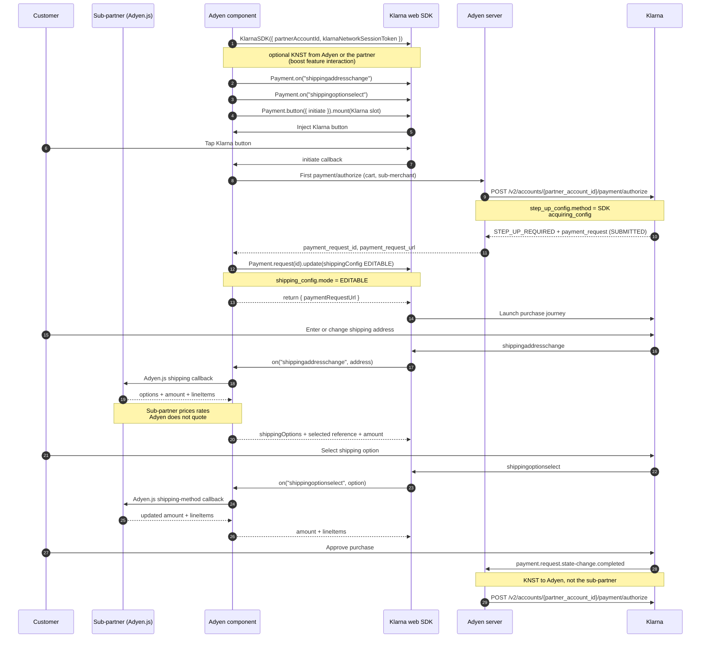
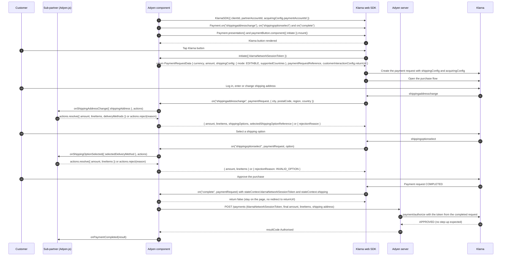

# Klarna Network Express flow: two options

This page compares two ways to run the Klarna Express flow (the shopper picks or edits the shipping address inside Klarna) with Adyen Web.

- **Option A: authorize first.** The flow from Klarna's diagram in the "Adyen - Discovery (External)" session on Sep 22, 2026. Adyen creates the Klarna payment request before the popup opens, and the browser then turns on editable shipping with `Payment.request(id).update()`. The POC follows this flow, and editable shipping does not work yet.
- **Option B: authorize last.** The flow from Klarna's public Web SDK docs. The Klarna Web SDK creates the payment request in the browser with `shippingConfig`, and Adyen Web calls `/payments` only after the shopper has approved in Klarna.

Status markers used below:

| Marker | Meaning                                                   |
| ------ | --------------------------------------------------------- |
| ✅     | Verified in a live test (Klarna playground, SDK v2.0.420) |
| ❌     | Verified in a live test to fail or not happen             |
| ❓     | Not verified yet; based on Klarna's docs or diagram       |

## Option A: authorize first (Klarna's diagram)

This diagram is a transcription of Klarna's diagram: same participants, steps, labels, arrow styles and notes. Klarna's screenshots end at step 29, so anything after it is missing here too. How the POC compares with each step is in the table below the diagram.

### How the POC compares

| Step  | Klarna's diagram                                                                    | POC today                                                                                                                                                                                                                         | Status                        |
| ----- | ----------------------------------------------------------------------------------- | --------------------------------------------------------------------------------------------------------------------------------------------------------------------------------------------------------------------------------- | ----------------------------- |
| 1     | `KlarnaSDK({ partnerAccountId, klarnaNetworkSessionToken })`; the token is optional | Starts with `clientId`, `partnerAccountId` and `acquiringConfig.paymentAccountId`, without a session token                                                                                                                        | ✅                            |
| 2–3   | Register both shipping handlers                                                     | Same, before the button mounts                                                                                                                                                                                                    | ✅                            |
| 4–5   | Mount the button with `initiate`; the SDK injects it                                | Uses `Payment.presentation()` and `paymentButton.component({ initiate }).mount()`                                                                                                                                                 | ✅                            |
| 6–7   | The customer taps the button and Klarna calls `initiate`                            | Same                                                                                                                                                                                                                              | ✅                            |
| 8     | First authorize with the cart and sub-merchant                                      | `POST /payments` with the session token and payment account id                                                                                                                                                                    | ✅                            |
| 9     | `step_up_config.method = SDK` and `acquiring_config`                                | The created request has `stateContext.customerInteraction.method = "HANDOVER"`                                                                                                                                                    | ❌ does not match             |
| 10    | `STEP_UP_REQUIRED` with a `SUBMITTED` payment request                               | `/payments` returns `RedirectShopper`, and the request is `SUBMITTED`                                                                                                                                                             | ✅                            |
| 11    | Adyen returns `payment_request_id` and `payment_request_url`                        | Only the URL, inside `action.url`. The local server unwraps it from the Adyen redirect page. The backend plans to return both values in the payment response; until then the POC reads the id from the URL with `Payment.fetch()` | ❓ URL only today; id planned |
| 12    | `Payment.request(id).update(shippingConfig EDITABLE)`                               | `Payment.request` is `undefined` in SDK v2.0.420, so the call throws and shipping never becomes `EDITABLE`                                                                                                                        | ❌                            |
| 13–14 | Return `{ paymentRequestUrl }`; the SDK launches the purchase journey               | Same. The popup opens. Reading the SDK code, its update carries only `acquiringConfig` and internal feature flags, never `shippingConfig`                                                                                         | ✅                            |
| 15–26 | Shipping address and shipping option events, priced by the sub-partner              | Handlers are wired to `onShippingAddressChange` and `onShippingOptionSelected`, but no shipping event fired in any live test                                                                                                      | ❌                            |
| 27    | The customer approves                                                               | Same                                                                                                                                                                                                                              | ✅                            |
| 28–29 | Klarna notifies the Adyen server, which authorizes again with the KNST              | Klarna redirects to `returnUrl` with `redirectResult`, and `/payments/details` returns Authorised. Whether the backend also receives the webhook is not visible from the browser                                                  | ❓ finishes differently       |

### What Option A needs

- **From Klarna:** a released `Payment.request(id).update()`, or another client-side way to set `shippingConfig` on a request that the Adyen server created. We also need to know whether step 9 must use `method = SDK` for this to work.
- **From the Adyen backend:** send `step_up_config.method = SDK` if Klarna requires it, return `payment_request_id` and `payment_request_url` in the `/payments` response (step 11, planned), and confirm how steps 28–29 map to today's `/payments/details` flow.
- **In Adyen Web:** once the backend returns the id, use it directly and drop the `Payment.fetch()` lookup. Step 12 is already called in `initiate` and starts working as soon as the SDK has `request()`.

## Option B: authorize last (Klarna's public docs)

Nothing in Option B has been tested live yet, so every step is ❓. The steps come from Klarna's Web SDK docs:

- [`InitiateCallback`](https://docs.klarna.com/websdk/v2/types/payment.InitiateCallback.html): `initiate` may return `PaymentRequestData`, `{ paymentRequestUrl }`, a deprecated `{ paymentRequestId }`, or `{ returnUrl? }`.
- [`PaymentRequestData`](https://docs.klarna.com/websdk/v2/interfaces/payment.PaymentRequestData.html): `shippingConfig` is only part of this shape. Without it Klarna shows no shipping form. With `EDITABLE`, the address is returned in `stateContext.shipping` when the request is `COMPLETED`, and the merchant must honour it. `READ_ONLY` is a "future release" and has no effect yet.
- [`Payment`](https://docs.klarna.com/klarna-network-distribution/web-sdk/Payment/): the shipping events must be answered within 10 seconds, and the `complete` handler can return `false` to stop the automatic redirect. Klarna's `complete` example sends `stateContext.klarnaNetworkSessionToken` to the backend for authorization.

### What Option B needs

- **From the Adyen backend:** accept a `klarnaNetworkSessionToken` from a completed payment request and authorize it without the step-up (redirect) it does today. `/payments` already sends `klarnaNetworkSessionToken`, so the request shape may already fit.
- **From Klarna:** confirm that client-side creation with `shippingConfig` is supported for acquiring partners, and which credentials the browser SDK must use to create the request.
- **In Adyen Web:**
    - `initiate` returns `PaymentRequestData` instead of calling `/payments`.
    - Add a `complete` handler that returns `false`, then calls `/payments` with the token, the final amount and the shipping details.
    - Add `PaymentRequestData` to `KlarnaInitiateResult` in `klarna-web-sdk-types.ts`.
    - Decide the `paymentRequestReference` value. Today Adyen sets it to its PSP reference, which doesn't exist yet when the browser creates the request.
    - Handle the redirect mode. On devices where Klarna redirects instead of opening a popup, `complete` fires when the return page loads, so the SDK must also run on that page.

## Comparison

|                                        | Option A: authorize first                                                                                      | Option B: authorize last                               |
| -------------------------------------- | -------------------------------------------------------------------------------------------------------------- | ------------------------------------------------------ |
| Who creates the Klarna payment request | Adyen server, during the first authorize                                                                       | Klarna web SDK, in the browser                         |
| When Adyen calls Klarna authorize      | Before the popup opens (step 9), and again after approval (step 29)                                            | Once, after the customer approves in Klarna            |
| How editable shipping is turned on     | `Payment.request(id).update({ shippingConfig })`                                                               | `shippingConfig` in the `initiate` return value        |
| Public Klarna API                      | No. `request()` is only in Klarna's diagram and missing from SDK v2.0.420                                      | Yes. `PaymentRequestData.shippingConfig` is documented |
| How the payment finishes               | Diagram: completed webhook to the Adyen server, then a second authorize. POC: redirect and `/payments/details` | `complete` event, then `/payments` with the token      |
| Backend change                         | `step_up_config.method = SDK` if required, return `payment_request_id` (planned), steps 28–29                  | Authorize a completed request's token without step-up  |
| Works today                            | Payment yes; editable shipping no                                                                              | Not tested                                             |

## Open questions for Klarna

1. Is `Payment.request(id).update()` planned? If so, in which SDK version, and is it behind a flag for our client id or partner account?
2. Does step 9 have to use `step_up_config.method = SDK`? Our requests are created with `HANDOVER`.
3. Your diagram ends at step 29 in our screenshots. What happens after the second authorize, and how does the browser learn the final result? Today the POC gets it through the `returnUrl` redirect and `/payments/details`.
4. Is Option B (client-side creation with `shippingConfig`, authorize on `complete`) the supported Express flow for acquiring partners today?
5. In Option B, can the acquiring partner authorize the token from a completed request without step-up? What does the authorize call need?
6. Our payment requests are created in Klarna's EU region (`krn:payment:eu1:...`, `/eu/` URLs) while the story runs in US/USD with test accounts that only work in North America. Can that affect Express features?
7. The docs say both 5 and 10 seconds for answering shipping events. Which one applies?
