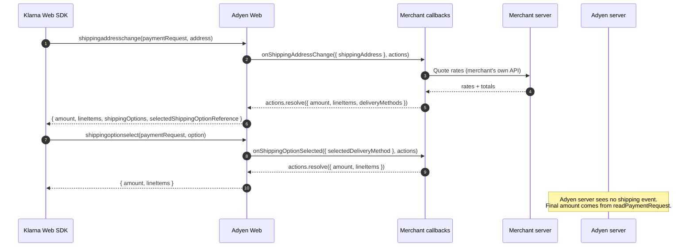
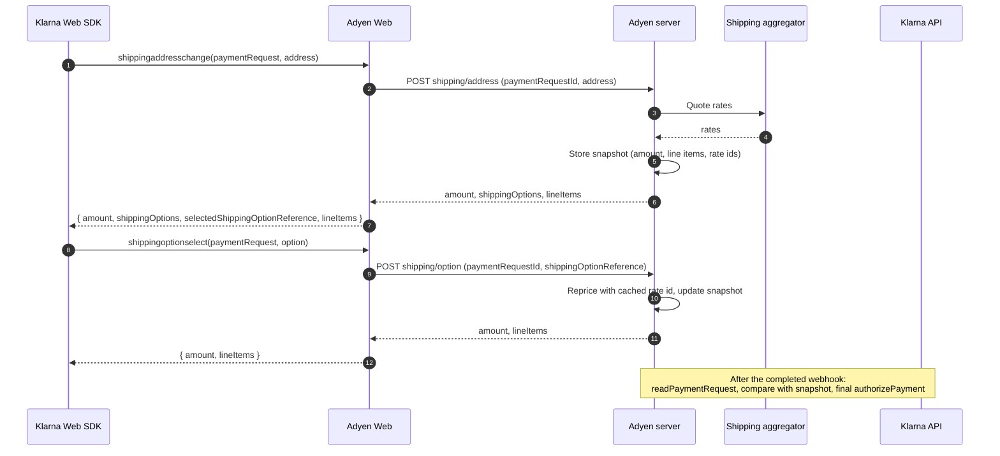

# Klarna Network Express Checkout: who prices shipping

During the Express flow, the Klarna Web SDK fires `shippingaddresschange` and `shippingoptionselect` in the browser. Something has to quote shipping rates and return new totals. There are two ways to do this. The POC uses option A. Klarna's docs describe option B.

The rest of the flow is the same in both options. See [KlarnaNetwork-Express-Checkout-TDD.md](./KlarnaNetwork-Express-Checkout-TDD.md).

## A. POC: the merchant prices shipping in Adyen Web callbacks

Adyen Web maps each Klarna event to a merchant callback. The merchant prices shipping (in the browser or by calling its own server) and resolves with Adyen-shaped data. Adyen Web maps the result back to Klarna's shape.

Klarna only sends the selected option reference on `shippingoptionselect`, so the merchant must remember the price it quoted for each reference.

The Storybook demo prices shipping in the browser (`stories/klarna-express-stories-utils.ts`). A real merchant should price on its server.

## B. Klarna's docs: the Adyen server prices shipping

The browser handlers only carry the address or option to the Adyen server. The Adyen server holds the shipping-aggregator credentials, quotes the rates, and stores a snapshot of the accepted amount, line items and selected option. The final authorization is reconciled against that snapshot.

## Comparison

|                                           | A. Merchant callbacks (POC)                                                                                                                                          | B. Adyen server (Klarna's docs)                                                |
| ----------------------------------------- | -------------------------------------------------------------------------------------------------------------------------------------------------------------------- | ------------------------------------------------------------------------------ |
| Who holds shipping-aggregator credentials | The merchant                                                                                                                                                         | The Adyen server                                                               |
| Where the snapshot is persisted           | Nowhere in Adyen. The merchant may keep its own.                                                                                                                     | Adyen server, keyed on `paymentRequestId`, updated on every successful handler |
| How the final amount is reconciled        | Adyen server trusts the `COMPLETED` payment request from `readPaymentRequest`. The merchant checks it on its side.                                                   | Adyen server compares the `COMPLETED` payment request with its stored snapshot |
| New endpoints                             | None. Uses the existing Adyen Web callbacks.                                                                                                                         | Two Adyen server endpoints for address and option, plus snapshot storage       |
| Latency inside the 5–10 second limit      | Browser to merchant server                                                                                                                                           | Browser to Adyen server to aggregator                                          |
| Match with PayPal and Apple Pay Express   | Same pattern: `onShippingAddressChange` and `onShippingOptionsChange` / `onShippingContactSelected` and `onShippingMethodSelected` with `actions.resolve` / `reject` | No equivalent in Adyen Web today                                               |
| Status                                    | Implemented in the POC                                                                                                                                               | Not implemented                                                                |

The POC keeps option A because it matches how the other Express payment methods in Adyen Web already work. Option B needs an Adyen server product decision.
